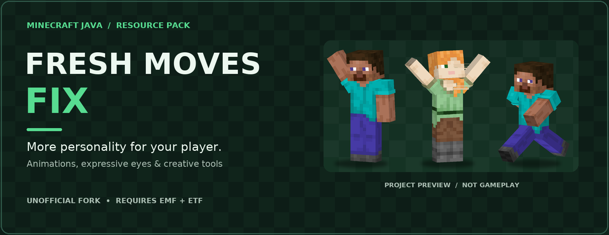
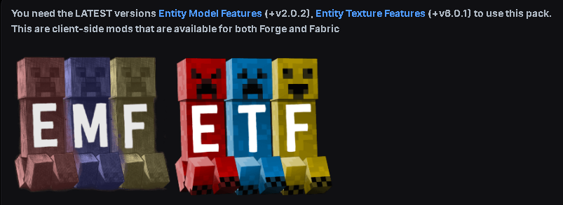
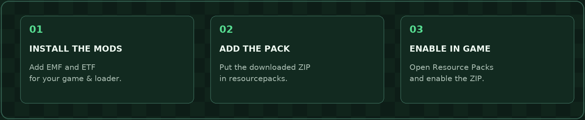
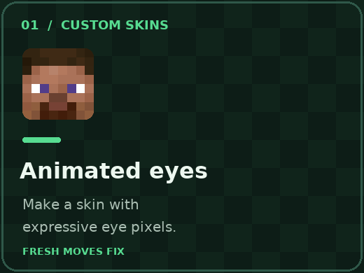
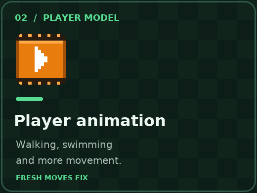
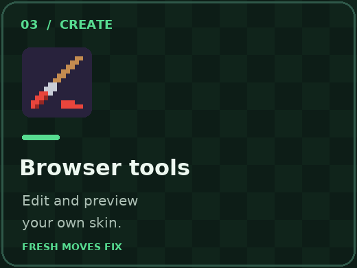
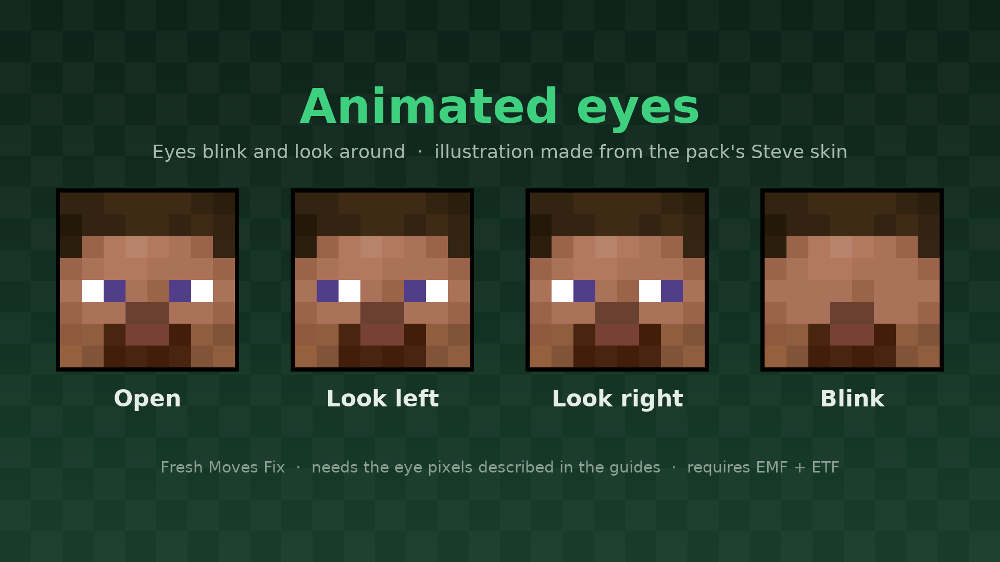
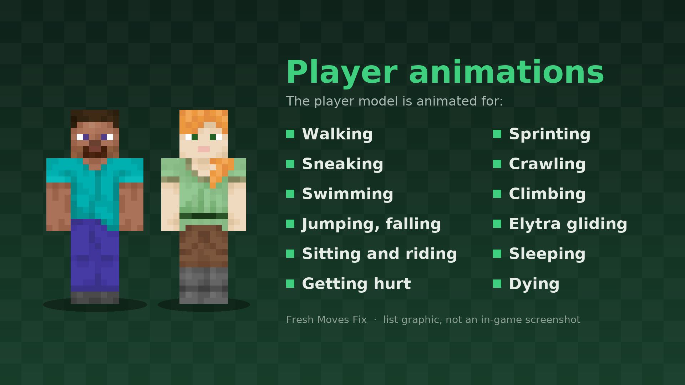
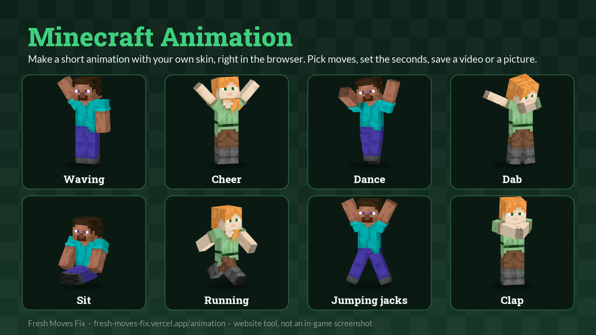

# Fresh-Moves-Fix



A Minecraft Java resource pack fork with player animations, animated eyes and browser-based skin tools.

## Get started


| Download | Create | Learn |
| :---: | :---: | :---: |
| [](https://github.com/BT-Studio-dev/Fresh-Moves-Fix/releases) | [](https://fresh-moves-fix.vercel.app/editor/) | [](docs/Home.md) |

[Download releases](https://github.com/BT-Studio-dev/Fresh-Moves-Fix/releases) · [Open the website](https://fresh-moves-fix.vercel.app/) · [Skin Eye Editor](https://fresh-moves-fix.vercel.app/editor/) · [Guides](docs/Home.md)

## Requirements



You need the **LATEST** versions of [Entity Model Features](https://modrinth.com/mod/entity-model-features) (+v2.0.2) and [Entity Texture Features](https://modrinth.com/mod/entitytexturefeatures) (+v6.0.1) to use this pack.
These are client-side mods that are available for Fabric, Forge and NeoForge.

On Minecraft 1.21.9 and newer use EMF 3.0.12 or newer, otherwise armour does not follow the animations.

On Minecraft 26.1, 26.1.1 and 26.1.2 use EMF 3.3.2 or newer (older versions do not start or crash there). On 26.3 use EMF 3.3.6 or newer. EMF for 26.x exists for Fabric and NeoForge.

## Installation




1. Install EMF and ETF for your Minecraft version and mod loader.
2. Download a pack ZIP and place it, without unzipping, in your Minecraft `resourcepacks` folder.
3. In Minecraft, open **Options → Resource Packs**, move the pack to the selected side and choose **Done**.

See [INSTALL.txt](INSTALL.txt) for more details.

## Guides

- [All guides (wiki home)](docs/Home.md)
- [All releases and Minecraft versions](docs/Versions.md)

## Preview


| Animated eyes | Player animation | Browser tools |
| :---: | :---: | :---: |
| [](docs/Home.md) | [](#changes-from-the-original-pack) | [](https://fresh-moves-fix.vercel.app/editor/) |

These illustrations were made with the website tools; they are not in-game screenshots. Features and compatibility can vary by Minecraft version and skin.

### Animated eyes



Use the [Skin Eye Editor](https://fresh-moves-fix.vercel.app/editor/) and [eye guides](docs/Home.md) to prepare your skin.

### Player animations



The graphic shows examples of the pack's intended animations; see the testing notes below before installing.

### Animation maker



Try the separate [Minecraft Animation maker](https://fresh-moves-fix.vercel.app/animation/) in your browser.

## Changes from the original pack


- Eyes stay closed while sleeping and after death (upstream issue #360).
- `v1_21_2/` overlay (loaded automatically on Minecraft 1.21.2+): the second skin layer (hat, jacket, sleeves, pants) no longer moves twice (upstream issues #211, #309).
- `pack.mcmeta` declares the overlay and the `min_format` / `max_format` fields that Minecraft 1.21.9+ expects.
- Sit emote (new in 3.1-fix5, untested): stand still, sneak and look straight down, and the player sits on the ground. Other players with the pack see it too.
- Talking mouth (new in 3.1-fix7, untested): tap sneak twice quickly while looking forward and the mouth keeps moving as if talking; double tap again to stop. It is a switch you press yourself, for use with voice chat; a resource pack cannot read Simple Voice Chat.
- Moving mouth (new in 3.1-fix6, untested): skins made with the Mouth option of the eye editor open the mouth when the player is hurt, cheers or waves. Marker: two pixels at x 60-61, y 32 of the skin file, in the colour of the open mouth.
- More emotes (new in 3.1-fix5, untested): stand still, look straight up and tap sneak: 1 wave, 2 cheer, 3 clap, 4 dab, 5 dance, 6 jumping jacks, 7 T-pose. Look away or walk to stop.
- Wave emote (new in 3.1-fix2): stand still, sneak and look straight up, and the right arm waves. Other players with the pack see it too.
- Added example skins `herobrine.png` and `alex_white_eyes.png`.
- Wiki pages copied to `docs/`; caption fixed in "Eyebrow (Villager)" (upstream issue #246).

None of the model changes have been tested in-game yet.

## Website

https://fresh-moves-fix.vercel.app

It includes a skin eye editor (https://fresh-moves-fix.vercel.app/editor/) that adds the eye pixels (2 wide, derp, 3 wide and simple eyes) to a skin and downloads the result, with a 3D preview (uses the MIT-licensed skinview3d library). Flag pictures in the language list come from flag-icons (MIT).

The site is in `website/`. It is generated from this repository (`docs/`, `VERSION`, `build.py`):

```
cd website
npm install
npm run build   # writes website/public
```

## Build

`python3 build.py` checks the pack files and writes the installable zips to `dist/`:

- `Fresh-Moves-Fix.zip` - one zip for all versions (Minecraft picks the right files itself)
- `Fresh-Moves-Fix-mc<version>.zip` - one zip per Minecraft version, 1.20 to 26.3 (24 versions)

`python3 build.py 26.3 1.21.5` builds only the listed versions.

The per-version zips carry the pack format number of that version so Minecraft does not show the "incompatible" warning. They have not been tested in-game.

## Releases

GitHub Actions runs the build on every push. On `main` it also publishes the zips as a GitHub release named after the `VERSION` file (tag `v<VERSION>`).
To publish a new release, change the text in `VERSION` (for example `3.1-fix4`) and merge to `main`. If the release already exists, its zips are replaced. A release can also be built from a branch: start the workflow by hand (Actions > Build pack > Run workflow) or put `[release]` in the commit message.
