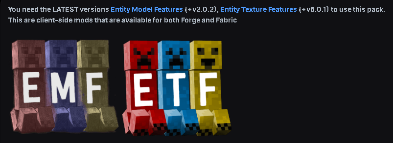

# Fresh-Moves-Fix

## Requirements



You need the **LATEST** versions of [Entity Model Features](https://modrinth.com/mod/entity-model-features) (+v2.0.2) and [Entity Texture Features](https://modrinth.com/mod/entitytexturefeatures) (+v6.0.1) to use this pack.
These are client-side mods that are available for Fabric, Forge and NeoForge.

On Minecraft 1.21.9 and newer use EMF 3.0.12 or newer, otherwise armour does not follow the animations.

## Guides

- [All guides (wiki home)](docs/Home.md)
- [All releases and Minecraft versions](docs/Versions.md)

## Changes from the original pack

- Eyes stay closed while sleeping and after death (upstream issue #360).
- `v1_21_2/` overlay (loaded automatically on Minecraft 1.21.2+): the second skin layer (hat, jacket, sleeves, pants) no longer moves twice (upstream issues #211, #309).
- `pack.mcmeta` declares the overlay and the `min_format` / `max_format` fields that Minecraft 1.21.9+ expects.
- Added example skins `herobrine.png` and `alex_white_eyes.png`.
- Wiki pages copied to `docs/`; caption fixed in "Eyebrow (Villager)" (upstream issue #246).

None of the model changes have been tested in-game yet.

## Website

https://fresh-moves-fix.vercel.app

The site is in `website/`. It is generated from this repository (`docs/`, `VERSION`, `build.py`):

```
cd website
npm install
npm run build   # writes website/public
```

## Build

`python3 build.py` checks the pack files and writes the installable zips to `dist/`:

- `Fresh-Moves-Fix.zip` - one zip for all versions (Minecraft picks the right files itself)
- `Fresh-Moves-Fix-mc<version>.zip` - one zip per Minecraft version, 1.20 to 26.3 (24 versions)

`python3 build.py 26.3 1.21.5` builds only the listed versions.

The per-version zips carry the pack format number of that version so Minecraft does not show the "incompatible" warning. They have not been tested in-game.

## Releases

GitHub Actions runs the build on every push. On `main` it also publishes the zips as a GitHub release named after the `VERSION` file (tag `v<VERSION>`).
To publish a new release, change the text in `VERSION` (for example `3.1-fix2`) and merge to `main`. If the release already exists, its zips are replaced.
